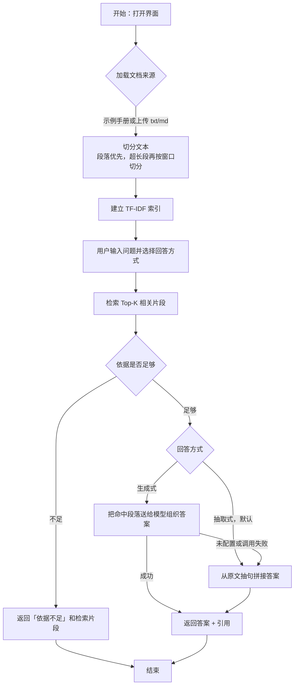
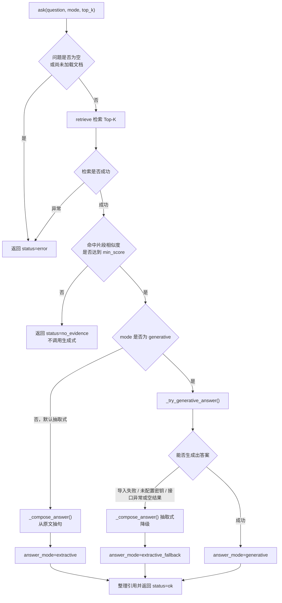
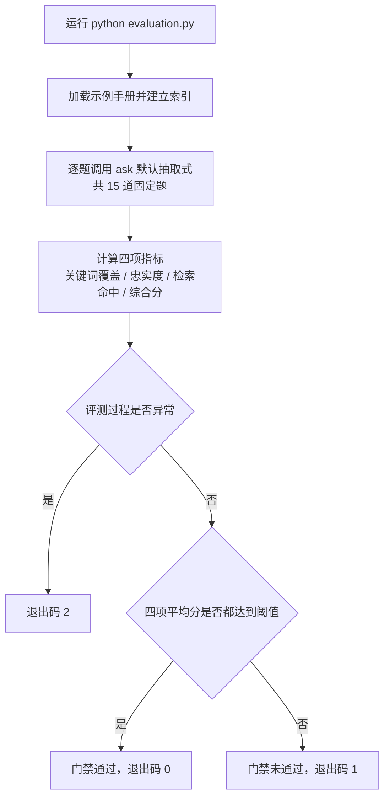

# CampusRAG-Eval 核心流程图

本文用 Mermaid 说明三条主路径，便于对照源码阅读。实现细节以 `rag_engine.py`、`app.py`、`generator.py`、`evaluation.py` 为准。

## 1. 整体问答流程

用户在 Streamlit 中加载文档并提问后，系统先建索引、再检索，最后按所选方式组织答案。生成式只在「已有足够依据」时才会被调用。

对应文件：`app.py`（界面与开关）→ `rag_engine.py`（切分、检索、作答）→ `generator.py`（可选生成式）。

## 2. `ask()` 内部决策流程

`mode` 只决定「怎么写答案」，不改变检索。默认是抽取式；生成式失败时自动降级，保证没有密钥也能回答。

阅读入口：`rag_engine.py` 中的 `ask()` 与 `_try_generative_answer()`。

## 3. 评测门禁流程

评测脚本默认走抽取式，不依赖外部模型。15 道固定题全部打分后，用平均分和阈值决定退出码，可接入 CI。

默认阈值：关键词 ≥ 0.60，忠实度 ≥ 0.70，检索命中 ≥ 0.70，综合分 ≥ 0.65。可用命令行参数覆盖。
